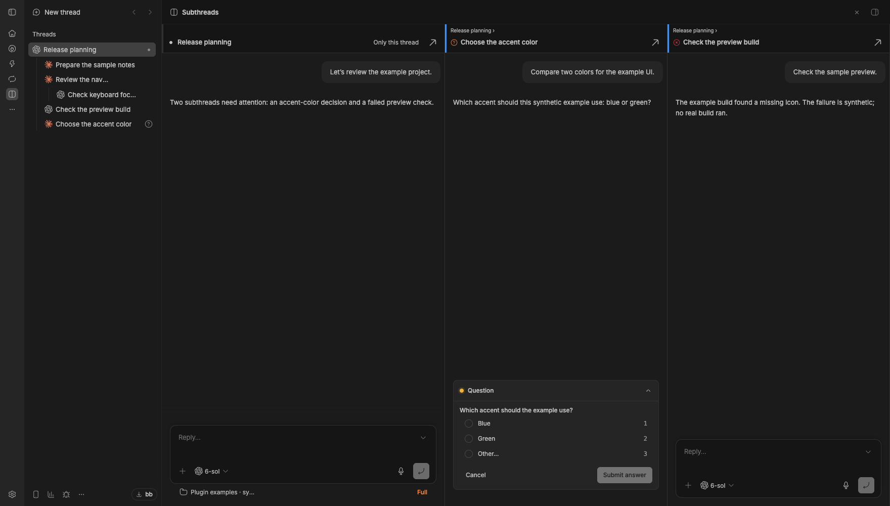

# Subthread Columns

Open a parent thread and answer the subthreads that need you in one horizontal page. Waiting and failed descendants work with BB alone; unread-result columns require the optional Responsibilities plugin, which is not included.

*Synthetic example data in BB 0.47.1, without Responsibilities.*

Each column has its own chat and composer. Depth stripes and paths show nesting. Working, hidden and archived descendants stay out. The default limit is eight descendant columns, with overflow shown as **+N more**. Click into a failed column and leave it to mark it seen in this browser; devices do not share that local mark.

Requires BB 0.47.1. Install `npm:bb-plugin-subthread-columns@0.1.0` in BB. Coming from Thread Columns 0.6.0? Save your actual settings before updating and follow [migration](MIGRATION.md).
