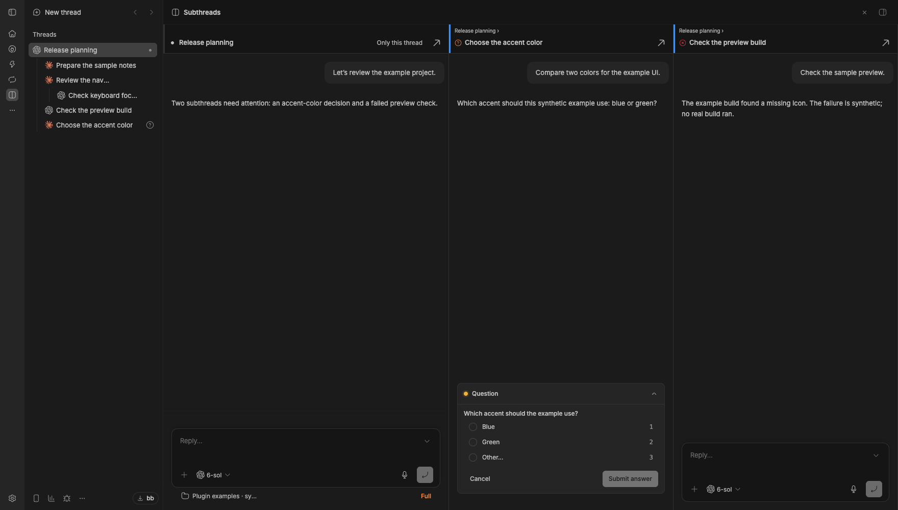

# Subthread Columns

A BB plugin for people who run many agent threads under one another. When you open a thread whose descendants need you, at any depth, it shows a column page instead of the plain thread view: the thread you opened on the left, then one column per such descendant, with one shared horizontal scroll. The thread's sidebar row stays marked as the current one.



*BB 0.47.1 with synthetic example data, without Responsibilities.*

## Who gets a column

- **Waiting.** A descendant waiting for your answer or approval, even while it runs, since its agent is blocked on you.
- **Failed.** An idle descendant that failed and that you have not seen since its last update.
- **Unread result.** An idle descendant holding a result you have not seen. This needs the Responsibilities plugin (`responsibilities`, not published yet), which records results and seen marks. Without it the plugin knows only BB's own data: waiting and failed descendants get columns, unread results do not.

A working descendant gets none: busy status, machine provisioning or waiting for its host, a workflow, background agent or command, plan mode or goal, or a queued message. Hidden and archived threads never do.

## Columns

- **Limit.** At most `Subthread columns limit` descendant columns (8 by default); your thread's column is extra. When more need you, those waiting for your answer come first, then failed ones, then unread results, and within each the newest by last update or, for a result, by its time. The chosen ones still show in tree order. Your thread's header then shows a muted **+N more**; hover it for their titles.
- **Order and nesting.** Tree order: a parent, then its children, depth first, siblings oldest first. A colored stripe marks the depth, and a muted line above the title shows the path, `Anchor › Parent ›`. A parent that needs nothing gets no column but still shows in its children's paths.
- **Columns.** Every column has the same composer as the thread page, and your thread's column is wider. Each column scrolls on its own and, like the thread page, follows the newest message. Focus starts in your thread's composer; a subthread's composer gets it only from a click into its column, from Tab, or from a key pressed inside that column. A column far off screen mounts its chat when you scroll near it; a sidebar update re-renders only the columns whose thread changed, never a chat. Each header has the status glyph, the title and **Open**, which shows that thread the usual way. The first column also has **Only this thread**.
- **Seen.** Your thread follows the usual rule: its result counts as seen while the page shows it in a visible, focused window. A descendant counts as seen only after you clicked into its column and then clicked or focused anything outside it, or left the page. Focus alone, by Tab or a script, never engages a column; a menu or picker opened from it keeps it engaged, and switching to another app does not count. Seeing clears its dot, and a failure stays out of the columns until it changes again. BB's own read tracking runs in every column, as in any thread chat with a composer, and for a child it marks read only a failure (or a thread you marked unread): a failed child's result dot clears once its column shows, while its ✕ and its column stay until you click in and leave.
- **Live changes.** A descendant that starts needing you gets its column at its place in the tree, briefly highlighted, if there is room. Records that arrive later, for example while Responsibilities reads the thread history after its first start, add columns the same way. On a full page a newcomer takes the place of the oldest done column you are not in; if there is none, it counts in +N more. Subthreads already counted there take only a free place, for example after you raise the limit, and otherwise wait for the next opening. The columns you are looking at do not move, and focus stays where it is. A column stays until you leave the page, even when it no longer needs you. While its thread works again, for example after your reply, it shows BB's spinner, counts toward the limit and is never replaced. Once idle and no longer needing you, it is done: dimmed, with a check mark. It is gone the next time. A column whose thread is archived or deleted disappears, unless you are in it.
- **When it opens.** Once per navigation to a thread, as soon as BB's thread list is loaded and Responsibilities has answered or turned out to be missing (it gives up after about 3s), and only if a descendant needs you: a thread whose subthreads only work opens plainly. A thread you open into a new split pane (Cmd/Ctrl-click or a drag) gets its columns in that pane. It does not open on phone-width windows, for a thread you focus in an existing split pane, or when a descendant becomes eligible while you stay on the plain thread view; that descendant counts the next time you open the thread. **Only this thread** goes back to the plain view and keeps it for this tab until a descendant that did not need you then starts needing you; that, too, takes effect on the next opening, not while you stay on the thread.

## Settings

Settings → Installed plugins → Subthread Columns:

- `Subthread columns`: `auto` (default) or `off`. `off` stops the automatic opening only.
- `Subthread columns limit`: any whole number from 1, 8 by default.

```sh
bb plugin config subthread-columns set columns off
bb plugin config subthread-columns set maxColumns 6
```

## With and without Responsibilities

- **Reading.** The plugin reads `list` from Responsibilities through BB's cross-plugin RPC (`pluginId: "responsibilities"`). The read is tagged `attention`, so it refreshes whenever Responsibilities records a result or a seen mark, and after BB reconnects. When a read fails, the last records it got stay in use.
- **Missing.** When Responsibilities is not installed or not running, the read fails at once and the page goes on with BB's own data. Enabling it while BB is open makes BB read its records right away. Disabling it keeps the last records in use until a reload.
- **Seen marks.** A seen mark goes to Responsibilities, and this browser also keeps it in its local storage. That copy keeps a seen failure out of the columns without Responsibilities, after a reload and in other windows of the same browser; another browser or device shows the failure again until you click in and leave there too. Two windows saving marks at the same moment can overwrite each other's local copy, so a failure may show once more; a mark Responsibilities stored stays. A mark made while Responsibilities was unavailable stays in this browser only and is not sent later, so its dot can still show in the sidebar.

## Coming from Model & Effort Badges 0.6

Thread Columns 0.6.0 used the `model-effort-badges` ID. Model & Effort Badges 0.7.0 shows badges only; install Subthread Columns 0.1.0 separately. See [migration](MIGRATION.md) before updating.

- **Settings.** Save actual `columns`, `maxColumns` and `placement` before updating. Follow [migration](MIGRATION.md), including the separate restoration of placement after a pinned-source reinstall.

- **Seen marks and results.** 0.6 kept them in its own database. Responsibilities takes them over on its first start. Without it, this plugin does not know which failures you saw before, so such a failure gets its column once more until you click in and leave.
- **Page address.** The page moved from `/plugins/model-effort-badges/columns/<thread id>` to `/plugins/subthread-columns/columns/<thread id>`. An **Only this thread** choice made before the update does not carry over.

## Install, update, uninstall

Requires BB 0.47.1 or later.

```sh
bb plugin install npm:bb-plugin-subthread-columns@0.1.0 --yes
bb plugin disable subthread-columns
bb plugin remove subthread-columns
```

For a tracking source, use `bb plugin update subthread-columns --yes`. To change a pinned version or installation source, save the plugin settings, remove its registration, install the desired version, then restore those settings individually. Removal resets settings. Source installation is also supported: `bb plugin install https://github.com/neoromantic/bb-plugin-subthread-columns#v0.1.0 --yes`.

## Compatibility

The plugin does not patch BB, its thread list or its database. What can break on an upgrade is the internal sidebar markup and the experimental APIs below. Then the page or its sidebar mark stops working and BB's own thread view works as before.

- A `navPanel` page (`/plugins/subthread-columns/columns/<thread id>`), so BB also lists **Subthreads** in the sidebar navigation (hide it there if you like). An app overlay (`experimental_appOverlay`) decides the automatic opening and marks the sidebar row.
- `ThreadChat` with `layout: "contained"`, `ThreadTitle`, `experimental_ThreadStatusGlyph`, `useBbNavigate().toPluginPanel` with `replace` for the redirect, `useSidebarSplitLayout` to spot a focused pane, `experimental_useSidebarThreads`, `experimental_useRpcQuery` and `useSdk().plugins.callRpc` for Responsibilities, `sessionStorage` for **Only this thread** and `localStorage` for the seen marks.
- Every column is the `compact` variant, which has the composer and BB's bottom-anchored scroll. BB's composer focuses itself, and scrolls itself into view, whenever it mounts; `ThreadChat` cannot turn that off, so the page returns that focus and its horizontal scroll to where they were. The plugin never calls BB's `markRead` or `markUnread`, and does not use `threads.open`, which would open the thread in every connected window.
- `useSidebarThreads` lists threads in the server's order, not the sidebar's, so siblings are ordered by `createdAt`. The page uses `max-width: 767px` as the phone-width test, like BB. BB 0.47.1 has no `--chart-*` colors, so the depth stripes use the plugin's own fallbacks.
- The current-row mark mirrors BB's selected row (`bg-state-active`, the `--state-active` color) with a `data-mea-current` attribute on `[data-sidebar-rename-row]`, found from `a[data-sidebar-thread-id]`. Those are internal BB DOM, not a public API.

## Data and access

The plugin adds no sidebar status marks, New child thread action or manager styling. The plugin stores nothing on the server. Its server part only defines the two settings. In the app it reads BB's thread list and Responsibilities' records, and keeps its seen marks in the browser's local storage. No telemetry.

## Develop

Use Bun.

```sh
bun install --frozen-lockfile
bun run check
bun test
bun run build
```
